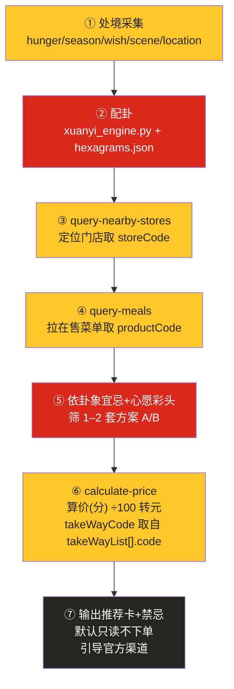

# MCP 集成说明（MCP_INTEGRATION）

## 一、使用的 MCP Server

| 项 | 值 |
|---|---|
| Server 名称 | `mcd-mcp` |
| 接入地址 | `https://mcp.mcd.cn` |
| 传输协议 | Streamable HTTP |
| 鉴权方式 | `Authorization: Bearer ${MCD_TOKEN}`（环境变量占位符，仓库不含真实 Token） |

脱敏配置示例见 `mcp-config.example.json`：
```json
{
  "mcpServers": {
    "mcd-mcp": {
      "type": "streamablehttp",
      "url": "https://mcp.mcd.cn",
      "headers": { "Authorization": "Bearer ${MCD_TOKEN}" }
    }
  }
}
```

## 二、实际调用的 Tool 清单

本 Skill 以**只读推荐**为 MVP，实际调用以下工具（名称均与官方指南一致）：

| Tool | 用途 | 是否默认调用 |
|---|---|---|
| `query-nearby-stores` | 查询附近可用门店，取 `storeCode` | ✅ 是 |
| `query-meals` | 查询门店在售餐品，取 `productCode` / 名称 / 标签 | ✅ 是 |
| `calculate-price` | 按选购商品算价（单位：分），返回 `takeWayList[].code` | ✅ 是 |
| `list-nutrition-foods` | 餐品营养成分，辅助温润 / 热量标注 | ✅ 可选 |
| `available-coupons` | 麦麦省可领券列表（仅展示，不自动领） | ✅ 可选 |
| `query-store-coupons` | 当前门店可用券（仅展示） | ✅ 可选 |

### 默认关闭的写操作（合规闸）
| Tool | 说明 |
|---|---|
| `create-order` | 创建订单（真实扣款）。**默认不调用**，如需下单引导用户前往麦当劳 App / 小程序 / 门店等官方渠道，且需用户明确确认。 |
| `auto-bind-coupons` | 一键领券。**默认不调用**，仅引导官方渠道。 |
| `mall-create-order` / `cancel-order` 等 | 同属写操作，**默认不调用**。 |

> 说明：官方指南未文档化逐工具参数 schema（storeCode / orderType / beType / beCode 等），最终以实时 `list_tools` 返回的 JSON Schema 为准；本 Skill 已遵循经验观测的配对规则（见下）。

## 三、调用流程图



### 关键参数配对规则（务必遵守，否则接口报错）
| 场景 | orderType | beType | beCode |
|---|---|---|---|
| 到店自取 | 1 | 1 | **不传** |
| 得来速 | 1 | 5 | **必传** |
| 麦乐送 | 2 | 2 | **必传** |

- 价格单位统一为**分**，展示一律 **÷100 转元**。
- `takeWayCode` 取自 `calculate-price` 返回的 `takeWayList[].code`，**不可硬编码**。

## 四、业务价值

- **趣味决策 × 真实数据**：把《易经》养生节制的文化趣味，与麦当劳 MCP 的**真实在售菜单、实时价格**结合，让"吃什么"从一个疲劳决策变成一次轻量、可玩的推演。
- **解决决策疲劳**：用处境配卦 + 心愿彩头降低选择成本，同时坚持"温润、节制、七分饱、不浪费"的健康导向，契合时令与当代养生趋势。
- **为 MCP 提供新颖创意场景**：以"只读推荐"安全落地，展示 MCP 在消费决策类创意应用中的可能性，且不触碰写操作合规红线。
- **可参与 WorkBuddy 专项奖励**：本 Skill 全程在 WorkBuddy 内由「代码小队」协作产品化（见 `workbuddy.md`），符合联动活动奖励核验条件。
